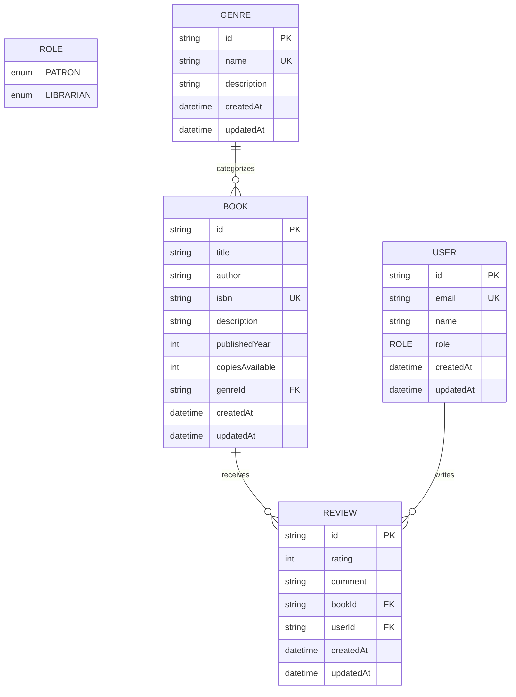

# Library Management System

A robust, relational data layer and catalog system for a modern library management platform, built with **Prisma ORM**, **TypeScript**, **NestJS**, and **PostgreSQL**.

---

## Table of Contents

- [Overview](#overview)
- [System Architecture & Data Models](#system-architecture--data-models)
- [Schema Decisions](#schema-decisions)
  - [Why Book References Genre Rather Than Embedding It](#why-book-references-genre-rather-than-embedding-it)
  - [Prisma vs. Document Database Modeling](#prisma-vs-document-database-modeling)
- [Entity Relationship Diagram](#entity-relationship-diagram)
- [Project Structure](#project-structure)
- [Setup & Migration Guide](#setup--migration-guide)
  - [1. Environment Configuration](#1-environment-configuration)
  - [2. Install Dependencies](#2-install-dependencies)
  - [3. Run Migrations](#3-run-migrations)
  - [4. Seed the Database](#4-seed-the-database)
  - [5. Inspect with Prisma Studio](#5-inspect-with-prisma-studio)
- [Verification & Deliverables Checklist](#verification--deliverables-checklist)

---

## Overview

The `library-management-system` data layer models the core domain of a library catalog:
- **Users & Roles**: Differentiated access between patrons (`PATRON`) and staff (`LIBRARIAN`) using an enumerated `Role` type.
- **Genre Taxonomy**: Normalized catalog classifications with metadata.
- **Book Catalog**: Physical and digital title inventory referencing canonical genres.
- **Reviews (Stretch Goal)**: Patron feedback and rating relations linking users and books with referential integrity.
- **Prisma Service**: Modular NestJS integration extending `PrismaClient` with lifecycle hooks.

---

## System Architecture & Data Models

### 1. `Role` Enum
```prisma
enum Role {
  PATRON
  LIBRARIAN
}
```
Defines strict role-based authorization at the database layer.

### 2. `User` Model
Represents library members and staff.
- `id`: Unique identifier (UUID).
- `email`: Unique email address.
- `name`: Display name.
- `role`: Role enum (`PATRON` by default).
- `reviews`: Relational list of reviews authored by the user.

### 3. `Genre` Model
Represents literary classifications.
- `id`: Unique identifier (UUID).
- `name`: Unique name (e.g., "Science Fiction", "Mystery & Thriller").
- `description`: Optional overview of the genre.
- `books`: Relational collection of books categorized under this genre.

### 4. `Book` Model
Represents catalog items.
- `id`: Unique identifier (UUID).
- `title`: Title of the book.
- `author`: Primary author name.
- `isbn`: Unique International Standard Book Number.
- `description`: Summary of the book.
- `publishedYear`: Original publication year.
- `copiesAvailable`: Total copies in circulation.
- `genreId`: Foreign key scalar referencing `Genre.id`.
- `genre`: Strongly-typed Prisma relation (`@relation(fields: [genreId], references: [id])`).
- `reviews`: Relational list of user reviews.

### 5. `Review` Model (Stretch Task)
Enables patrons to rate and review catalog books.
- `id`: Unique identifier (UUID).
- `rating`: Integer score (1–5).
- `comment`: Optional written critique.
- `bookId`: Foreign key referencing `Book.id`.
- `userId`: Foreign key referencing `User.id`.
- `book` / `user`: Relational links with cascade delete constraints.

---

## Schema Decisions

### Why Book References Genre Rather Than Embedding It

In designing the catalog schema, a fundamental architectural choice is whether to embed genre data directly inside each book record (e.g., storing a string `genre: "Science Fiction"` or a embedded object) or to normalize `Genre` as a standalone relational table referenced via a `genreId` foreign key and `@relation`.

We chose to model **`Genre` as an independent entity referenced by `Book`** for the following architectural reasons:

1. **Third Normal Form (3NF) & Single Source of Truth**:
   Genres possess their own domain lifecycle, identity, and metadata (such as descriptions, taxonomy tags, or curation notes). By maintaining a separate `Genre` table, each genre is defined exactly once. This eliminates data redundancy and prevents typographic drift across books (e.g., preventing books from having `"Sci-Fi"`, `"SciFi"`, `"Science-Fiction"`, and `"Science Fiction"` simultaneously).

2. **Elimination of Update and Deletion Anomalies**:
   If a genre is renamed, reorganized, or its description is updated, modifying a single row in the `Genre` table immediately updates the catalog across all referenced books. In an embedded/denormalized model, renaming a genre requires mutating potentially tens of thousands of book records in a resource-intensive and error-prone batch transaction.

3. **Relational Indexing & Query Performance**:
   Using a foreign key index on `Book.genreId` allows the database engine to execute high-speed joins, index scans, and aggregations. Queries such as counting available books per genre (`GROUP BY genreId`), filtering catalog items by genre, or locating unpopulated genres (`LEFT JOIN WHERE book.id IS NULL`) execute with $O(\log n)$ efficiency.

4. **Referential Integrity & Cascading Constraints**:
   Relational foreign keys guarantee referential integrity at the database engine level. A book cannot reference a nonexistent genre. Furthermore, constraint rules (such as `ON DELETE RESTRICT` or `ON DELETE CASCADE`) provide predictable and deterministic data management behaviors.

5. **Future-Proofing for Many-to-Many Expansions**:
   While currently modeled as a One-to-Many relation (`Genre 1 : N Book`), isolating `Genre` as a distinct model makes migrating to a Many-to-Many relationship (e.g., books with multiple genres via an explicit join table `_BookToGenre`) seamless and non-destructive.

---

### Prisma vs. Document Database Modeling

> **Stretch Reflection: What Felt Different Modeling in Prisma vs. a Document Database**

Coming from a document database background (such as MongoDB with Mongoose), several fundamental paradigms feel distinctly different when modeling with Prisma:

1. **Schema Contracts and Upfront Relationship Rigor**:
   In document stores, relationships are flexible and often implicit. One frequently embeds sub-documents (such as embedding reviews directly into a book document or storing genres as an array of strings) to optimize for single-document read queries without joins. In Prisma, relations require explicit bidirectional contracts: both the scalar foreign key (`genreId`, `bookId`) and the relation navigation properties (`genre`, `book`, `reviews`) must be defined on both participating models.
   
2. **Migrations as Code vs. Dynamic Schema Mutation**:
   In document databases, adding a field or altering a relation can be done on the fly without schema locks, deferring validation to the application runtime. With Prisma and relational engines, every schema adjustment is codified as a declarative, version-controlled SQL migration script (`prisma migrate dev`). This provides compile-time safety and prevents orphaned data, but requires deliberate architectural planning before persisting data.

3. **Query-Time Hydration via Explicit `include` / `select`**:
   In document databases, an embedded review or genre is returned automatically with the parent document. In Prisma, nested data is intentionally excluded by default to avoid accidental over-fetching, requiring developers to explicitly opt-in using `include: { genre: true, reviews: true }`. This separation guarantees optimal query performance while retaining full type inference.

---

## Entity Relationship Diagram



---

## Project Structure

```
library-management-system/
├── README.md                          # Schema decisions, architecture, and setup instructions
├── .gitignore                         # Root gitignore
└── api/
    ├── .env.example                   # DATABASE_URL placeholder
    ├── .gitignore                     # Node/Prisma gitignore
    ├── package.json                   # Dependencies, build, and seed scripts
    ├── tsconfig.json                  # TypeScript compiler configuration
    ├── prisma/
    │   ├── schema.prisma              # Prisma schema (Role, User, Genre, Book, Review)
    │   └── seed.ts                    # Seeding script (5 genres, 18 books, users, reviews)
    └── src/
        └── prisma/
            ├── prisma.service.ts      # PrismaService extending PrismaClient & OnModuleInit
            ├── prisma.module.ts       # Global NestJS module export
            └── index.ts               # Barrel export
```

---

## Setup & Migration Guide

### 1. Environment Configuration

Copy the example environment file inside `api/`:

```bash
cd api
cp .env.example .env
```

Edit `api/.env` and insert your PostgreSQL connection string:

```env
DATABASE_URL="postgresql://<USER>:<PASSWORD>@<HOST>:<PORT>/<DATABASE>?schema=public"
```

> **Note**: Compatible with any hosted PostgreSQL service (e.g., Supabase, Neon, Railway, Render) or a local PostgreSQL instance.

### 2. Install Dependencies

Install the required npm packages:

```bash
npm install
```

Generate the Prisma Client:

```bash
npx prisma generate
```

### 3. Run Migrations

Apply the database migrations to your PostgreSQL database:

```bash
npx prisma migrate dev --name init
```

For production or CI environments, deploy existing migrations with:

```bash
npx prisma migrate deploy
```

### 4. Seed the Database

Run the seed script to populate the database with default genres, books, users, and reviews:

```bash
npm run seed
```

Or invoke the Prisma CLI seed runner:

```bash
npx prisma db seed
```

#### Seeding Summary
- **Genres Seeded (5)**:
  - Science Fiction
  - Fantasy
  - Mystery & Thriller
  - Historical Fiction
  - Non-Fiction
- **Books Seeded (18)**:
  - *Dune*, *Neuromancer*, *Foundation*, *Snow Crash* (Science Fiction)
  - *The Hobbit*, *A Game of Thrones*, *The Name of the Wind*, *The Way of Kings* (Fantasy)
  - *The Girl with the Dragon Tattoo*, *The Da Vinci Code*, *Gone Girl*, *And Then There Were None* (Mystery & Thriller)
  - *All the Light We Cannot See*, *The Book Thief*, *The Pillars of the Earth* (Historical Fiction)
  - *Sapiens: A Brief History of Humankind*, *Educated*, *Thinking, Fast and Slow* (Non-Fiction)
- **Users Seeded**:
  - `patron@library.org` (`Role.PATRON`)
  - `librarian@library.org` (`Role.LIBRARIAN`)
- **Reviews Seeded**:
  - Sample patron ratings and reviews on seeded titles.

### 5. Inspect with Prisma Studio

Launch the visual data browser:

```bash
npx prisma studio
```

Navigate to `http://localhost:5555` to browse and manage your records.

---

## Verification & Deliverables Checklist

| Required Deliverable | Target File | Status | Notes |
| :--- | :--- | :---: | :--- |
| **Prisma Schema** | `api/prisma/schema.prisma` | ✅ | Includes `Role` enum (`PATRON`, `LIBRARIAN`), `User`, `Genre`, `Book` with `@relation(fields: [genreId], references: [id])`, and `Review` stretch model. |
| **Seed Script** | `api/prisma/seed.ts` | ✅ | Inserts 5 genres and 18 books (exceeding 4+ genres and 15+ books requirement), plus sample users and reviews. |
| **Prisma Service** | `api/src/prisma/prisma.service.ts` | ✅ | Extends `PrismaClient`, implements `OnModuleInit`, and calls `await this.$connect()` in `onModuleInit()`. |
| **Env Example** | `api/.env.example` | ✅ | Contains generic `DATABASE_URL` placeholder without leaking credentials. |
| **Schema Decisions** | `README.md` | ✅ | Detailed `## Schema Decisions` section explaining relational normalization over embedding, plus document database comparison. |
